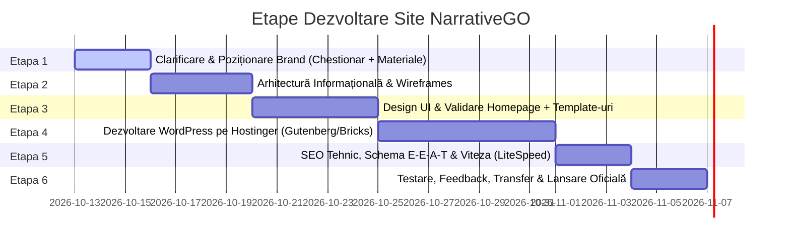

# Plan Strategic & Arhitectură Web: NarrativeGO (Personal Brand Krisztina Hegedűs)

## 1. Analiza Situației & a Draftului HTML Primit

### 1.1. Ce funcționează bine în draftul Claude:
- **Structura logică generală**: Împărțirea pe secțiuni (Hero, Who We Help, Services, Results, Process, Contact) are un flux logic bun.
- **Copywriting inteligent**: Mesajele de tip *"SEO that serves the business goal, not just the ranking"* sau *"Happy team, happy roadmap"* sună bine și transmit maturitate strategică.
- **Micro-interacțiuni**: Folosirea subtilă a animațiilor (GSAP ScrollTrigger, linia de marquee, counter-ele) dă o senzație de dinamism.

### 1.2. Ce TREBUIE schimbat radical (Gap-uri majore):
1. **Disonanța dintre „Personal Brand” și Copy-ul de „Agenție”**:
   - În draftul curent, tot textul este la persoana I plural (*„we help you”*, *„where we fit best”*, *„what we bring”*).
   - **Nu există nicio fotografie cu Krisztina**, nicio față umană, nicio semnătură personală.
   - Un site de personal brand se vinde prin **încredere în persoană** (față, nume, acreditări, voce unică). Trebuie trecut la persoana I singular (*„Te ajut să...”*, *„Abordarea mea...”* sau o fuziune armonioasă: *„Krisztina Hegedűs | NarrativeGO”*).
2. **Contextul critic: Clienta este specialistă SEO**:
   - Dacă site-ul unui specialist SEO se încarcă greu sau are erori tehnice, își pierde instant credibilitatea în fața clienților.
   - Pe WordPress, site-ul trebuie construit **ultra-rapid** (Core Web Vitals impecabile, TTFB sub 200ms, scor 95+ pe Google PageSpeed).
   - Necesită date structurate native (**Schema.org: Person, Service, BlogPosting, FAQ**).
3. **Culorile & Contrastul**:
   - Verdele specificat `#015147` (Deep Pine/Forest) combinat cu portocaliul `#F79F48` (Warm Tangerine) este o combinație excelentă: transmite stabilitate, creștere (verde) și energie/creativitate (portocaliu).
   - În draft s-au folosit nuanțe derivate (`#07433B`, `#11695D`). Trebuie standardizată o paletă clară cu contrast WCAG AAA pentru lizibilitate maximă.

---

## 2. Recomandare Tehnică (WordPress pe Hostinger)

### 2.1. De ce să NU folosim Elementor:
- Elementor este greoi, generează cod DOM supradimensionat (DOM bloat) și îngreunează Core Web Vitals (LCP, INP, CLS). Pentru un specialist SEO, un site pe Elementor este adesea un handicap tehnic.

### 2.2. Soluția Recomandată (High Performance & Scalabilitate):
- **Opțiunea A (Standard Modern - Gutenberg / Block Theme)**:
  - Temă lightweight: **Blocksy** sau **GeneratePress** (ambele cu cod impecabil).
  - Builder de blocuri: **GenerateBlocks** sau **Kadence Blocks** (zero bloat, viteză nativă).
- **Opțiunea B (Visual Site Builder Avansat)**:
  - **Bricks Builder**: Cel mai curat cod din ecosistemul WordPress, flexibilitate totală pe template-uri dinamice și Custom Post Types.
- **Optimizare Server (Hostinger)**:
  - Hostinger rulează pe **LiteSpeed Web Server**.
  - Setup dedicat cu **LiteSpeed Cache plugin** + Object Cache (Redis/Memcached) + optimizare imagini WebP/AVIF. Rezultatul: încărcare instantă (<1 secundă).

---

## 3. Arhitectura Paginilor & Structura Recomandată

### A. Pagina Principală (Homepage) — Personal Branding Focus
1. **Header**: Logo, Navigație (Despre mine, Servicii, Blog, Contact), Buton CTA evidențiat (*„Programează un apel”* / *„Hai să vorbim”*).
2. **Hero Section (Personal Hook)**:
   - Titlu clar: Cine este, ce problemă rezolvă și pentru cine (*„Strategie SEO & Content care transformă căutările în clienți profitabili”*).
   - Fotografie profesională, dar prietenoasă cu Krisztina (decupată sau într-un cadru modern cu accent de brand verde/portocaliu).
   - Social proof imediat: *„Specialistă SEO cu peste 40+ de proiecte optimizate”* + badge-uri/logo-uri de industrii/clienți.
3. **Manifest / De ce NarrativeGO**:
   - Mesajul scurt al Krisztinei despre diferența dintre „trafic de vanitate” și „trafic care convertește”.
4. **Serviciile Cheie (Preview)**:
   - 3-4 carduri interactive cu link direct către fiecare serviciu.
5. **Cifre / Rezultate & Testimoniale**:
   - Mini-studii de caz: creșteri de trafic organic, poziționare pe cuvinte cheie comerciale, recenzii reale de la clienți.
6. **Procesul de Lucru (4 Pași simpli)**:
   - Audit & Cercetare -> Strategie -> Implementare conținut & Tehnic -> Monitorizare & Scalare.
7. **Secțiune Lead Magnet / Ultimele Articole din Blog**:
   - Demonstrează expertiza direct pe prima pagină.
8. **Contact & Call to Action Direct**:
   - Formular integrat sau link direct de calendar (Calendly/TidyCal).

### B. Secțiunea Servicii & Template Reutilizabil
- **Pagina generală de Servicii**:
  - Prezentare de ansamblu a soluțiilor (SEO Strategic, Copywriting axat pe conversie, Audit Tehnic & UX, E-commerce SEO, Creștere Autoritate E-E-A-T).
- **Template Reutilizabil pentru Serviciu Individual (Single Service Template)**:
  - Hero serviciu: Titlu, subtitlu de impact, cui i se adresează.
  - Provocarea: Ce probleme întâmpină clienții în acest domeniu.
  - Soluția & Ce include pachetul (Deliverables clare, sub formă de checklist/carduri).
  - Etapele de livrare (Timeline orientativ).
  - FAQ specific serviciului (ajută masiv la SEO prin FAQ Schema).
  - CTA dedicat de ofertă pentru acel serviciu specific.

### C. Pagina „About Me” (Despre Krisztina)
- Povestea ei profesională: de la ce a pornit, parcursul, experiența practică.
- Filozofia NarrativeGO: de ce SEO narativ, de ce conținut orientat pe utilizator și nu doar pe algoritmi.
- Competențe, certificări, tool-uri stăpânite (Ahrefs, SEMrush, Screaming Frog, GSC, GA4).
- Fotografii personale/profesionale autentice.

### D. Blog & Template Articol (Focus E-E-A-T & Google Freshness)
- **Arhiva de Blog**: Căutare rapidă, filtrare pe categorii (SEO Tehnic, Content, E-commerce, Strategie).
- **Template Articol (Single Post)**:
  - Header meta complet: **Data publicării** + **Data ultimei actualizări** (Google adoră actualizările de conținut SEO!).
  - Timp estimat de lectură & Categorie.
  - **Author Box de sus & de jos**: Foto Krisztina, Nume, Scurt Bio, Link către LinkedIn / Pagina Despre Mine (semnal puternic Google E-E-A-T).
  - Table of Contents generat automat (ancore interne esențiale pentru articole lungi).
  - Schema Markup generat automat: `BlogPosting` cu autor, date, imagine optimizată.
  - CTA la final de articol: *„Vrei o strategie personalizată pentru afacerea ta? Hai să vorbim.”*

---

## 4. Etapele de Lucru (Roadmap Proiect)

### Detalierea etapelor:
1. **Etapa 1: Aliniere & Materiale (1-3 zile)**
   - Obținere poze de brand (esențiale pentru personal branding).
   - Stabilire listă finală de servicii.
   - Clarificare acces Hostinger.
2. **Etapa 2: Arhitectură & Structură Conținut (3-4 zile)**
   - Creare schelet pagini (Sitemap & Wireframe text).
   - Adaptare copy de la „noi” la „eu / Krisztina”.
3. **Etapa 3: Prototip Design & Identitate Vizuală (4-5 zile)**
   - Rafinare paletă culori: `#015147` (Verde), `#F79F48` (Portocaliu), nuanțe neutre de fundal (`#FBFBF9`, `#FFFFFF`, `#1A2E2B`).
   - Mockup Homepage + Template Serviciu + Template Articol.
4. **Etapa 4: Dezvoltare WordPress (5-7 zile)**
   - Instalare WordPress curat pe Hostinger.
   - Creare temă / template-uri personalizate (FSE / Gutenberg / Bricks).
   - Implementare sistem dinamic pentru servicii și blog.
5. **Etapa 5: Optimizare SEO Tehnic & Performanță (2-3 zile)**
   - Configurare Schema.org (Person, Author, Service, Article).
   - Configurare LiteSpeed Cache pentru scor 95+ Core Web Vitals.
   - Verificare accesibilitate și securitate (SSL, Cloudflare/Hostinger CDN).
6. **Etapa 6: QA, Feedback & Go Live (2-3 zile)**
   - Testare pe mobil, tabletă, desktop.
   - Conectare Google Search Console & Google Analytics 4.
   - Predare ghid video scurt pentru adăugare articole și servicii noi.
